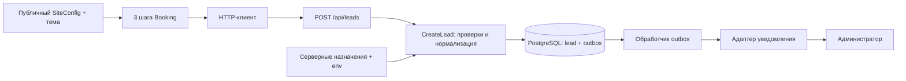

# Архитектура v1

## Состав

Модульный монолит: Next.js App Router + TypeScript + Tailwind, серверный Node.js runtime, PostgreSQL через pg. Канал доставки заявок настраивается под заказчика. Монорепозиторий, отдельный API-сервис и конструктор произвольных процессов не требуются.



Обозначения на схеме — целевая архитектура, не уже реализованные сервисы.

## Границы

1. **Контент/тема:** один SiteConfig, CSS-переменные и ограниченные варианты композиции. Auto/Beauty не содержат отдельной логики отправки.
2. **Booking UI:** три шага, выбранные значения, поля и понятные состояния. Серверные секреты и драйвер БД сюда не импортируются.
3. **Application:** нормализует запрос, проверяет доступные услуги/ресурсы и время, рассчитывает снапшот цены из конфигурации; не зависит от React и Telegram.
4. **Adapters:** PostgreSQL, доставка уведомления, планировщик, ограничение частоты. Через интерфейсы, без абстрактной платформы плагинов.
5. **Transport:** тонкий route.ts переводит HTTP в application и обратно. Только Node.js runtime, без edge-доступа к pg.

Публичный SiteConfig не содержит leadDestination, chat_id, токенов и DATABASE_URL. Назначение определяется по серверному siteKey, а не по URL из тела запроса.

Публичные данные для UI и сервера берутся из одного examples/sites/*.json. Обёртки src/config/sites и src/server/config/sites не создают независимые копии прайса; серверная обёртка добавляет только разрешения режима и приватные назначения.

## Канал заказчика

Для каждого siteKey сервер хранит primaryDestinationKey. Назначение содержит adapterId и ссылки на защищённые настройки получателя/учётных данных. Возможные адаптеры: telegram, email, crm-webhook; конкретный провайдер и формат определяются после выбора заказчика. Универсальный обязательный канал отсутствует.

В P0 одна заявка создаёт одно задание для одного согласованного назначения. Несколько одновременных каналов, автоматическое переключение при ошибке и все провайдеры заранее не реализуются. Для demo/тестов используется recording-адаптер без внешней отправки; live требует настроенного и проверенного адаптера.

Worker выбирает NotificationPort через явный реестр адаптеров. destinationKey сохраняется с заданием и обозначает неизменяемую версию назначения, например auto-admin-v1. При смене получателя создаётся новая версия; старая доступна до завершения её очереди. Ошибка или неизвестное назначение не перенаправляют заявку другому получателю. Канал, адрес и credentials клиент не присылает; интерфейс и OpenAPI остаются общими.

## Карта файлов и владельцы

Строки ниже — целевые пути. Наличие папки в схеме не означает, что модуль уже реализован.

| Путь | Ответственность | Владелец |
| --- | --- | --- |
| contracts/openapi.json | Запрос/ответ/ошибки, версия 1.0.0 | Архитектор |
| contracts/site-config.schema.json | Публичная конфигурация | Архитектор |
| examples/sites/*.json | Синтетические Auto/Beauty | Архитектор |
| src/app/demo/[siteKey]/page.tsx | Выбор разрешённого сайта, metadata, тема | Агент 1 |
| src/app/demo/[siteKey]/privacy/page.tsx | Политика для соответствующего режима | Агент 1 |
| src/features/booking/ui/BookingFlow.tsx | Контроллер трёх шагов | Агент 1 |
| src/features/booking/ui/{OfferStep,PreferenceStep,ContactStep}.tsx | Три экрана и состояния | Агент 1 |
| src/features/booking/client/lead-client.ts | HTTP, timeout, идемпотентный повтор | Агент 1 |
| src/themes/{technical,editorial}.css | Токены и визуальная оболочка | Агент 1 |
| src/config/sites/{auto,beauty}.ts | Данные, проверенные по схеме | Агент 1 |
| src/shared/contracts.ts | Общие замороженные TypeScript-типы по JSON-схемам | Архитектор |
| src/app/api/leads/route.ts | HTTP-адаптер | Агент 2 |
| src/app/api/internal/outbox/route.ts | Защищённый запуск обработки | Агент 2 |
| src/server/leads/{create-lead,validation,ports}.ts | Сценарий, валидация и порты | Агент 2 |
| src/server/config/sites.ts | Allowlist, mode, назначения | Агент 2 |
| src/server/db/{pool,lead-repository,outbox-repository}.ts | Параметризованный SQL и транзакции | Агент 2 |
| src/server/notifications/{dispatch,registry,ports}.ts | Повторы, реестр и общий интерфейс доставки | Агент 2 |
| src/server/notifications/adapters/*.ts | Recording для тестов и выбранный заказчиком провайдер | Агент 2 |
| db/migrations/*.sql | Версионируемые миграции | Агент 2 |
| scripts/backend/{migrate,export-leads,purge-leads}.mjs | Операции администратора | Агент 2 |
| tests/{ui,e2e}/** | UI/браузер | Агент 1 |
| tests/{backend,integration}/** | Сервер и реальная тестовая БД | Агент 2 |

Для PR3-BATCH-2 общие типы уже закреплены в src/shared/contracts.ts. Это явные типы по утверждённым схемам; автоматический генератор не подключён и не требуется для начала работы. Runtime-проверки используют JSON-схемы. Разработчики не создают независимые копии Lead/SiteConfig. Большие задания и общий смысл интеграции уточнены в docs/09-batch-contract.md.

## Модель данных

Для полного демонстрационного блока используются пять служебных сущностей, не бизнес-CRM:

- **leads:** id UUID; site_key text; config_version text; lead_kind='booking'; service_id/resource_id; service_options jsonb с серверной проверкой; preferred_at timestamptz; timezone; телефон text в нормализованном формате; имя nullable; consent_version и consent_at/created_at timestamptz от сервера; status='new'; price_snapshot jsonb из сервера; attribution jsonb с разрешёнными ключами; idempotency_key UUID; payload_hmac text. UNIQUE(site_key,idempotency_key).
- **notification_outbox:** id UUID; lead_id FK с каскадным удалением; adapter_id; destination_key; status pending/processing/sent/dead; attempts; next_attempt_at; lease_until; claim_token UUID; last_error_code без тела ответа. UNIQUE(lead_id) для одного назначения в P0, индекс для очереди по status/next_attempt_at и индекс FK. destination_key фиксирует версию назначения на момент создания задания.
- **rate_limits:** site_key + HMAC(IP,секрет) + окно времени; атомарный счётчик и expires_at; уникальность ключа окна. Исходный IP не хранить. Лимиты: 5 новых попыток за 10 минут на IP/site и 100 за час на site; успешные повторы по тому же ключу не расходуют лимит.
- **schema_migrations:** номер применённой миграции и время. Повторный запуск мигратора безопасен.
- **notification_receipts:** долговременное синтетическое свидетельство recording-адаптера; UUID, уникальный outbox_id, lead_id FK CASCADE, site_key, destination_key, adapter_id, payload jsonb и created_at. Эта таблица не является настоящим каналом администратора.

Режим demo использует отдельную БД/namespace и только синтетический номер. В приложение не попадает клиентский доступ к таблицам; миграционная роль отдельно от ограниченной runtime-роли. Индекс (site_key,created_at DESC) — для выборки администратором. Для цены — целые копейки, не float.

Предпочтение по времени не имеет уникального ограничения по ресурсу/часу: пересечение допустимо, потому что бронь не создаётся. Реальная запись получит отдельную модель и транзакционные ограничения на следующем этапе.

## Надёжность запроса

```mermaid
sequenceDiagram
  participant UI as Браузер
  participant API as API
  participant DB as PostgreSQL
  participant W as Outbox worker
  participant T as Канал администратора
  UI->>API: JSON + Idempotency-Key
  API->>API: Проверки и канонизация
  API->>DB: BEGIN; lead + outbox; COMMIT
  DB-->>API: Сохранено
  API-->>UI: 201 received + leadId
  W->>DB: Атомарно взять готовую запись
  W->>T: Доставить уведомление с leadId
  T-->>W: Результат
  W->>DB: sent либо следующий повтор
```

Нет fire-and-forget после ответа HTTP. Outbox обрабатывается отдельным коротким запуском раз в минуту через системный cron или планировщик выбранного хостинга. Публичный internal route требует Bearer-секрет, запрещён для браузера. Процесс может аварийно завершиться: lease обеспечивает возврат задачи в очередь. Перед обновлением статуса проверять claim_token, чтобы просроченный worker не перезаписал новую попытку.

Повторы: максимум 8 попыток; задержки после неудач 1, 5, 15, 30, 60, 120, 240 минут. Учитывать Retry-After/провайдерский retry_after. После лимита dead и ручной повтор администратором. Доставка как минимум один раз: после сбоя между отправкой и записью sent возможен дубль уведомления с тем же leadId. Уведомление не считается точно однократным.

## Время, цена и восстановление

Europe/Moscow задаёт смысл выбранных даты и времени. В API — локальные YYYY-MM-DD/HH:mm + timezone, в БД — соответствующий timestamptz. Сервер проверяет календарную дату, будущее время, горизонт 30 дней и настроенные часы/шаг. Эти часы — допустимые пожелания, а не наличие ресурса.

Цена и название услуги сохраняются снапшотом из разрешённой серверной конфигурации. Клиент не присылает цену. Версия контента и согласия обязательна; изменение прайса или согласия требует обновления формы с понятным сообщением.

Состояние формы и Idempotency-Key живут в памяти страницы. Переход назад и сетевой сбой не стирают поля. Телефон не сохраняется в localStorage, URL, аналитике и session replay. Полная перезагрузка страницы может сбросить контактные данные; это ожидаемое ограничение P0.

## Окружения

Локально и в CI — только синтетика, PostgreSQL в Docker для интеграционных тестов. Preview/demo — noindex, сбор реальных контактов выключен. Для live-клиента — отдельные env и БД при общем коде. Разрешённые siteKey и привязка домена задаются сервером; клиент не может выбрать другой канал уведомлений.

Конкретный production-провайдер и регион ещё не выбраны. Приложение должно запускаться как обычный Node.js сервер или контейнер. Vercel допустим для демонстрации; приём реальных данных требует отдельного решения владельца о месте хранения и доступах.
