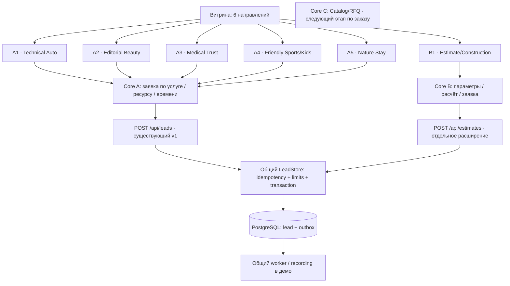

# Карта проекта: 3 ядра, 6 оболочек

Дата: 18.11.2026. Документ возвращает исходный масштаб 01_ROADMAP. Прежние планы OBLIK описывают один подробный пример, а не всю фабрику.

## Продуктовые уровни

1. **Фабрика /** — витрина шести направлений для разговора с заказчиком.
2. **Оболочки** — собственные композиции, изображения, содержание и переходы в сценарий.
3. **Ядра** — правила записи, расчёта или запроса КП.
4. **Общий сервер заявок** — нормализация, идемпотентность, лимиты, сохранение и доставка.

## Матрица оболочек

| Код | URL | Что выбирает человек | Ресурс | Что означает время |
| --- | --- | --- | --- | --- |
| A1 | /demo/auto | Работа/параметры авто | Скрыт | Пожелание по визиту. |
| A1, подробный пример | /demo/detailing | Программа и часть автомобиля | Скрыт | Пожелание по осмотру/визиту. |
| A2 | /demo/beauty | Услуга | Необязательный мастер | Пожелание, подтверждаемое администратором. |
| A3 | /demo/medical | Приём/организационная консультация | Демо-специалист | Пожелание; медицинские сведения не собираются. |
| A4 | /demo/sports | Пробное занятие | Демо-тренер | Пожелание; свободная ёмкость не заявляется. |
| A5 | /demo/stay | Дом / консультация о поездке | Скрыт | Время обратной связи, не период проживания. |
| B1 | /demo/estimate | Параметры окна | Не используется | Заявка на уточнение/замер, без обязательной даты. |

У всех шести есть демо-политика. Подробный OBLIK сохраняет 14 страниц. Для остальных первую глубину определяет смысл сценария: полноценный первый экран, содержательные услуги/объекты, подход, вопросы и работающая заявка. Следующая итерация добавляет отдельные страницы там, где это полезно клиенту.

## Дерево кода и зависимости

~~~text
src/
  app/
    page.tsx                         # витрина шести оболочек
    demo/[siteKey]/page.tsx           # реестр и оболочка, без бизнес-формул
    demo/[siteKey]/privacy/page.tsx   # правила конкретного демо
    demo/detailing/**                # сохранённый подробный Auto-пример
    api/leads/route.ts               # транспорт Core A
    api/estimates/route.ts           # транспорт Core B
  features/
    prototypes/
      catalog.ts                     # 6 стабильных направлений, маршруты, ссылки
      profiles.ts                    # редакторское содержание и визуальная подача
      PrototypeLanding.tsx           # сборка секций
      BookingEntry.tsx                # встраивание Core A, контекстные подписи
      sections.tsx                   # шапка/подвал/раскрываемые вопросы
      styles.css                     # изолированные семантические токены
    booking/{client,ui}/**            # существующий Core A
    estimate/
      domain.ts                      # чистая целочисленная формула и границы
      EstimateFlow.tsx                # управляемые этапы, поля, согласие/HTTP/квитанция
      EstimateLanding.tsx             # собственная подача B1
      WindowDrawing.tsx               # схема выбранной конструкции
      estimate.css                    # адаптивные поля/результат/квитанция
    detailing/**                     # отдельная композиция, тот же Core A
  shared/
    contracts.ts                     # сохранённый Booking v1
    estimate-contracts.ts             # параметры / quote / запрос Core B
  server/
    estimates/{config,schema,create-estimate}.ts
    http/{leads-handler,estimates-handler}.ts
    leads/{canonical,phone,matching,store-port}.ts
    db/**                            # общий PgLeadStore
    notifications/**                 # общий outbox worker и адаптеры

examples/sites/{auto,beauty,detailing,medical,sports,stay}.json
examples/calculators/estimate.json
contracts/openapi.json               # Booking v1 остаётся совместимым
contracts/estimates.openapi.json      # новое расширение
contracts/estimate-request.schema.json
db/migrations/003_estimate_leads.sql
tests/{backend,integration,ui,e2e,system}/**
~~~

Публичный контент не импортирует server/** и env. Формула не импортирует React, Next или pg. Контроллеры не содержат SQL. Оболочки не выбирают канал администратора. Цены для записи берутся из SiteConfig, для расчёта — из разрешённых сервером rates. Не строим универсальный конструктор плагинов, CRM или шесть одинаковых копий BookingFlow.

## Контракт Core A

Существующие serviceId, resourceId, serviceOptions и preferred проверяются по серверной конфигурации. Время — пожелание. Ошибка уведомления не отменяет сохранённую заявку. Повтор по siteKey/idempotency-key не создаёт второй lead.

Малые UI-параметры встраивания не меняют HTTP-формат: уровень заголовка, управление начальным фокусом и подпись времени для обратной связи.

## Контракт Core B

Подробности: [контракт расчёта](14-estimate-contract.md).

Запрос содержит параметры и согласие, но не доверенную цену. Сервер заново рассчитывает quote и сохраняет его в price_snapshot вместе с версией формулы. Техническая квитанция общая по смыслу с Booking: только после атомарного сохранения.

Общий PgLeadStore продолжает отвечать за сериализацию ключа, replay, лимиты и lead+outbox. kind расширяется совместимой миграцией до booking/estimate. Core C позже потребует отдельного контракта и проверки файлов.

## Единица конфигурации

**SiteConfig Core A:** публичные услуги, ресурсы, часы пожелания, политика и демо-режим.

**EstimateSiteConfig Core B:** публичные диапазоны параметров, ставки, версия формулы, допущения и политика.

**PrototypeProfile:** собственное название концепта, сцены, изображения, FAQ и контекст формы. Источником цены не является.

**Private RuntimeConfig:** allowlist сайтов, секреты, привязки назначений и режимы; наружу не сериализуется.

## Добавление нового клиента

1. Выбрать Core A или B и подходящую оболочку.
2. Подготовить фактический контент и конфигурацию, не копировать бизнес-логику.
3. Назначить серверный канал, окружение и правила данных.
4. Пройти единый контрактный и сквозной набор проверок.
5. Выпустить только реально проверенные возможности.

Мебель и клининг подключаются к Calculator после первого оконного сценария. Проживание с ночами и спорт с ёмкостью расширяют модель, а не переименовывают обычную заявку в подтверждённую бронь.

## Матрица проверки

| Уровень | Что защищает |
| --- | --- |
| Конфиги | Уникальность ключей, ссылки, схема, отсутствие секретов. |
| Domain | Целочисленная цена, диапазоны, шаги, допущения и количество. |
| Application | Пересчёт сервером, replay/conflict, версии, mode-readiness, допустимые поля. |
| PostgreSQL | Совместимая миграция, два kind, общий outbox, конкурентность. |
| Browser | Шесть входов, ресурсы, вычисление, возврат, ошибки, согласие, доступность. |
| System | Каждый прототип → настоящий HTTP → БД → recording. |

## Реестр готовности

Статусы записываются в отчёте текущего коммита. Существующий рабочий Booking и готовый OBLIK не равны завершённости всех шести оболочек. Core C и специальные ночи/ёмкость считаются запланированными, пока нет кода и проверок. Политики, документы, отзывы и фотографии реального клиента не заменяются выдуманными подтверждениями.
