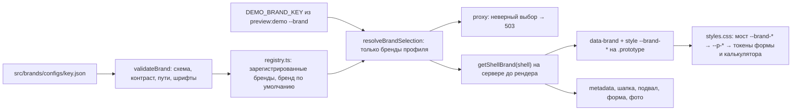

# ADR-009. Бренд клиента поверх отраслевой оболочки

**Статус:** предложено, проверено POC на Beauty (MIRA, ВЕЧЕР) и Calculator (ПРОСВЕТ, ТЕПЛО). Ветка `codex/client-demo-branding`. Инструкция оператора — [runbook](runbooks/client-brand.md), свидетельства — [отчёт](reports/client-branding.md).

## Контекст

Аудит базового коммита `2b8fbd8` показал, что айдентика не имела одного источника:

| Что | Где было | Проблема |
| --- | --- | --- |
| Имя в шапке, меню, подвале, подписи фото | `catalog.ts → brand` через пропсы | одна строка без полного имени |
| Имя в форме Booking | `SiteConfig.brandName` (`Студия · Демо` у Beauty) | расходилось с шапкой |
| Имя в калькуляторе и его RSC-данных | литерал `ПРОСВЕТ` ×3 в `EstimateLanding`, `estimate.json → brandName` | вторая копия имени уходила в клиентский payload |
| Заголовок вкладки | 6 маршрутов собирали `p.brand` по-своему, `calculator` — литерал | |
| Заголовок страницы команды | `pages.ts`: «Мастера MIRA» | утечка имени в чужой бренд |
| Цвета | `--p-*` на `.prototype-<shell>`, мост в токены формы; калькулятор — 17 прямых литералов | ошибки и успех формы не следовали палитре |
| Шрифты | `"Oblik Sans"`/`"Oblik Serif"` прямо в правилах | смена требует правки CSS |
| Контраст | `muted` на `surface`: Beauty 4,11, Estimate 4,23, Stay 4,32 | ниже 4,5 для текста |

## Решение

**Валидируемый конфиг бренда в Git + выбор из зарегистрированных конфигов при запуске процесса + CSS custom properties на корневом контейнере оболочки.**

1. **Оболочка** — композиция, разделы, навигация, сценарий (`.prototype-<shell>`, страницы, BookingFlow/EstimateFlow). **Бренд** — то, что посетитель воспринимает как компанию: короткое и полное имя, логотип, схема, палитра, шрифты, главное фото, слоган/подзаголовок/лид, описание. Услуги, цены, ставки, согласие и версии контрактов остаются в SiteConfig/estimate.json. Секреты, БД и назначения уведомлений — в env.
2. **Схема** `brand/1` (`src/brands/types.ts`, проверка в `validate.ts`). Обязательны `key`, `version`, `shell`, `synthetic: true`, `name.short ≤24`, `name.full ≤80`, `scheme`. Опциональны `logo.onLight/onDark`, `palette` (11 ролей), `typography`, `media.hero`, `copy`, `metadata`. Неизвестные поля, разметка в текстах, внешние URL, `..`, чужие папки ассетов, шрифты вне каталога и веса без файлов отклоняются.
3. **Порядок fallback:** выбранный бренд своей оболочки → бренд по умолчанию оболочки → пресет оболочки (имя из `catalog.ts`, цвета и шрифты из `styles.css`). Без логотипа для текущей схемы — текстовый знак. Без `palette`/`typography`/`hero` — значения пресета. Публичное имя не подменяет оператора данных: политика говорит об этом прямо.
4. **Применение.** `getShellBrand()` выполняется на сервере в layout-компонентах и `generateMetadata`, поэтому HTML приходит уже с нужными переменными: нет вспышки темы и расхождения SSR/гидрации. Клиентские компоненты получают только готовые строки и пути.

### Токены в три слоя

| Слой | Где | Пример |
| --- | --- | --- |
| 1. Сырые значения | JSON бренда | `"accent": "#e8b98c"` |
| 2. Роли | inline `--brand-*` на `.prototype[data-brand]` | `--brand-accent`, `--brand-font-display` |
| 3. Токены компонентов | мост в `styles.css`, `estimate.css` | `--p-accent`, `--color-accent`, `--e-field-line` |

| Роль бренда | Оболочка `--p-*` | Форма Booking | Калькулятор |
| --- | --- | --- | --- |
| canvas | `--p-bg` | `--bg-base`, `--bg-surface` | фон страницы |
| surface | `--p-surface` | `--bg-surface-elevated/hover/active` | `--e-soft` (смесь с raised) |
| raised | `--p-raised` | — | фон панели, полей, `--e-frame` |
| ink / muted | `--p-ink` / `--p-muted` | `--text-main` / `--text-muted`, `--text-faint` | текст / `--e-hint` |
| line | `--p-line` | `--border-default`, `--border-accent` | разделители; `--e-field-line` из muted |
| accent / onAccent | `--p-accent` / `--p-on` | `--color-accent(-hover)`, `--color-accent-contrast`, бейдж «Демо» | шаги, кнопки, чекбокс |
| focus | `--p-focus` | `--border-focus` | outline полей |
| danger | `--p-danger` | `--error-text/border/bg` | ошибка поля, блок ошибки |
| success | `--p-success` | `--success-*` | знак квитанции |
| scheme | `color-scheme` | `color-scheme` нативных контролов | |
| display / body | `h1,h2` / корень | заголовки формы — body | заголовок шага — body |

Конфиг проверяет пары: ink, muted на canvas/surface/raised ≥ 4,5; onAccent/accent ≥ 4,5; accent на canvas/surface ≥ 3; focus на трёх фонах ≥ 3; danger на canvas/raised ≥ 4,5; success/canvas ≥ 3; тёмная схема требует тёмный canvas. Радиусы, интервалы, размеры заголовков и форма фото остаются пресетом оболочки — это её отраслевая композиция.

Шрифты — каталог `src/brands/fonts.ts`: `oblik-sans` (400/500/600), `oblik-serif` (400), системные стеки. Гарнитура добавляется файлом WOFF2 с лицензией, `@font-face` и строкой каталога. Браузер загружает только используемые начертания: ВЕЧЕР и ПРОСВЕТ не запрашивают serif-файлы, MIRA и ТЕПЛО запрашивают.

## Сравнение вариантов

| | A. Конфиг в Git, выбор при запуске (выбрано) | B. Конфиг в Git, бренд при сборке | C. Набор конфигов, загружаемых во время работы (файлы/БД/админка) |
| --- | --- | --- | --- |
| Новый бренд | JSON + строка реестра + ассеты → `build` (8–12 с) | то же | без сборки |
| Переключение между готовыми | перезапуск процесса с `--brand`, без сборки | новая сборка на каждый бренд, отдельная `.next` для параллельного показа | без перезапуска |
| SSR и кэш | оболочки с одним брендом статичны; с двумя и более — рендер на запрос (`connection()`), HTML не кэшируется | всё статично | всё динамично, плюс кэш конфигов и инвалидация |
| Аудит и откат | `git log`/`git checkout` конфига, `version` в диагностике | так же | нужен журнал изменений и права |
| Ошибка во входных данных | падает `check:brands` и сборка; неверный ключ при запуске → 503 | падает сборка | обнаруживается во время показа |
| Изоляция | выбор ограничен профилем, siteKey/API/цены не меняются | так же | новые пути доступа к конфигам |

**Цена выбора A:** страницы Beauty и Estimate (у каждой теперь два бренда) рендерятся на запрос, раньше они были SSG. Замер TTFB: p50 3 мс против 1 мс у статичной Medical ([отчёт](reports/client-branding.md)). Для демо с одним зрителем это допустимо. Добавление бренда всё ещё требует сборки, потому что JSON импортируется и валидируется на этапе бандла — так невалидный конфиг не может попасть в работающий процесс. Вариант C оправдан только с кабинетом оператора, который сейчас вне границ (ADR-006).

**Цена выбора против B:** B проще по рендерингу, но для показа двух брендов рядом нужны две сборки и две папки `.next`. A показывает оба бренда из одного артефакта, что и проверяет `test:brands:system`.

## Изоляция и эксплуатация

- `DEMO_BRAND_KEY` задаёт только `preview:demo --brand`; унаследованное значение из оболочки оператора сбрасывается. Неизвестный бренд, бренд другой оболочки или бренд при неверном профиле → `proxy` отвечает 503, как при неверном `DEMO_SITE_KEY`, без имени бренда в ответе.
- В фабричном режиме выбранный бренд меняет только свою оболочку; остальные остаются по умолчанию.
- `siteKey`, `serviceId`, `resourceId`, `configVersion`, allowlist API и серверный расчёт не зависят от бренда. Системный тест сравнивает payload двух брендов: совпадают.
- `brandName` в SiteConfig/estimate.json остаётся только как поле контракта; на экран и в RSC-данные идёт `brand.name.full`.

## Затронутые файлы

| Область | Файлы |
| --- | --- |
| Механизм | `src/brands/{types,fonts,validate,registry,select,server,style,metadata}.ts`, `src/brands/configs/*.json` |
| Ассеты | `public/demo-assets/brands/{vecher,teplo}/` |
| Компоненты | `PrototypeHeader.tsx`, `sections.tsx`, `PrototypeLanding.tsx`, `DemoPages.tsx`, `EstimateLanding.tsx`, `pages.ts` (заголовок команды) |
| Стили | `styles.css` (мост, логотип, перенос имени), `estimate.css` (литералы → токены) |
| Маршруты | `src/app/demo/[siteKey]/**/page.tsx` (metadata), `privacy/page.tsx` |
| Запуск | `src/proxy.ts`, `scripts/demo-preview-options.mjs`, `scripts/preview-runtime.mjs`, `scripts/preview-runner.mjs` |
| Проверки | `tests/ui/brand.test.mjs`, `scripts/check-brands.mjs`, `scripts/test-brand-previews.mjs`, `package.json` (`check:brands`, `test:brands:system`) |

Изменения за пределами зоны фронтенда, на рассмотрение архитектору: `src/proxy.ts` (одна проверка бренда до решения о маршруте), `scripts/preview-*.mjs` (флаг `--brand`, явный `DEMO_BRAND_KEY`), две команды в `package.json`. `contracts/**`, SiteConfig, API и серверная изоляция `siteKey` не менялись.

## План миграции

Каждый шаг — отдельный небольшой PR: конфиг бренда по умолчанию + замена литералов оболочки на роли + скриншоты 390/1440 + `test:brands:system` с парой брендов.

| Шаг | Оболочка | Что сделать | Исключения |
| --- | --- | --- | --- |
| 1 | Medical | конфиг ЯСНО, `--p-*` уже полные; `brand-mark` с фоном accent | контраст muted/surface 4,73 проходит |
| 2 | Stay | конфиг ТИШЕ; градиент героя и светлая кнопка на фото → роли `heroOverlay`, `onPhoto` | muted/surface 4,32 — затемнить muted |
| 3 | Sports | конфиг ДВИЖ; цвета 2-й и 3-й карточек, оранжевый тег, бейджи формы → дополнительные роли или вывод из accent | курсивный жирный логотип — пресет оболочки |
| 4 | Auto | тёмная схема по умолчанию; `.prototype-auto .prototype-booking-host { color-scheme: dark }` заменить на `--brand-scheme` | связка со ссылкой на OBLIK |
| 5 | Витрина `/` | брать имя карточки из `defaultBrand()` | — |
| 6 | OBLIK | `--dt-*` (`detailing.css`, `site.css`, `art-direction.css`) связать с ролями через тот же мост на `.detailing-site`; имя/логотип в `SiteHeader`/`SiteFooter` | фильм и кадры (`film-shots.json`, видео), световой этюд и карта зон остаются материалами оболочки; их палитра не перекрашивается брендом, бренд меняет только UI-слой вокруг сцен. Управление видео и reduced motion не трогать |

## Ограничения

- Добавление нового бренда требует сборки (8–12 с локально); переключение между готовыми — нет.
- Только синтетические бренды (`synthetic: true`). Live-бренд с юридическими данными — отдельный этап вместе с публичной средой.
- Новые гарнитуры кроме Manrope/Cormorant в POC не добавлялись: каталог готов, файлы нужно согласовать по лицензии.
- Сравнение двух брендов — на двух превью; отдельная тестовая страница не делалась, чтобы не расширять маршруты.
