# Отчёт. Бренд клиента: POC на Beauty и Calculator

22.11.2026, ветка `codex/client-demo-branding` от `2b8fbd8`. Решение — [ADR-009](../18-client-branding.md), инструкция — [runbook](../runbooks/client-brand.md).

## Что показано

Один production build, четыре процесса превью, общие маршруты, компоненты и сценарии заявки.

| Оболочка | По умолчанию | Второй бренд | Чем отличается второй бренд |
| --- | --- | --- | --- |
| Beauty | MIRA: светлая пудровая палитра, Cormorant в заголовках, текстовый знак | ВЕЧЕР: тёмная схема, шампань-акцент, Manrope 500, SVG-логотип, вечерний кадр, свой слоган и лид | имя, логотип, фон, акцент, шрифты, карточки, форма, ошибки, квитанция, вкладка, подвал |
| Estimate | ПРОСВЕТ: холодный синий, Manrope | ТЕПЛО: тёплый крем и терракота, Cormorant, логотип-рама, тёплый кадр | то же плюс поля, схема окна и блоки калькулятора |

### Сравнение экранов (слева по умолчанию, справа второй бренд)

| Экран | 390 px | 1440 px |
| --- | --- | --- |
| Beauty, главная | 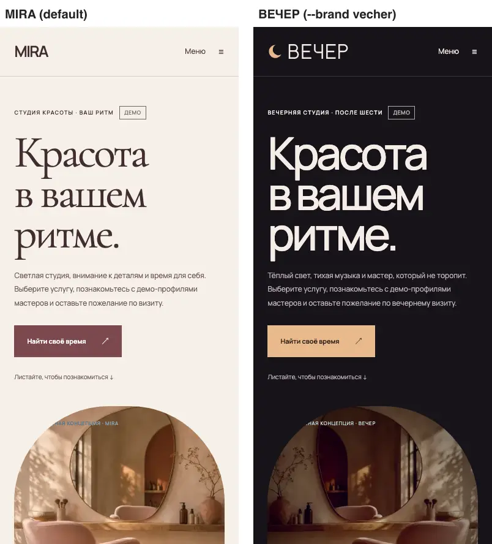 | 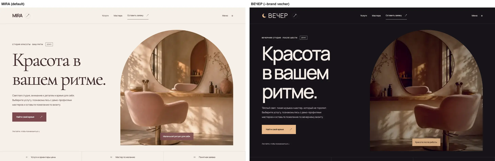 |
| Beauty, каталог | 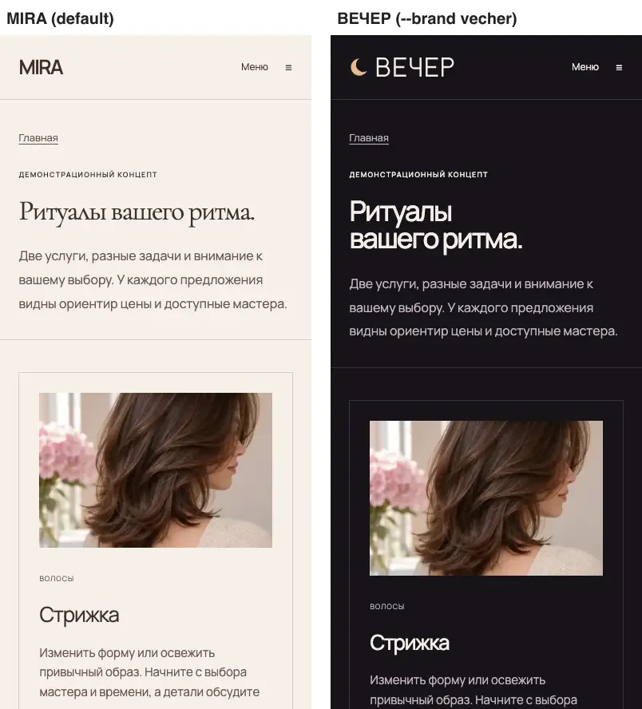 |  |
| Beauty, форма | 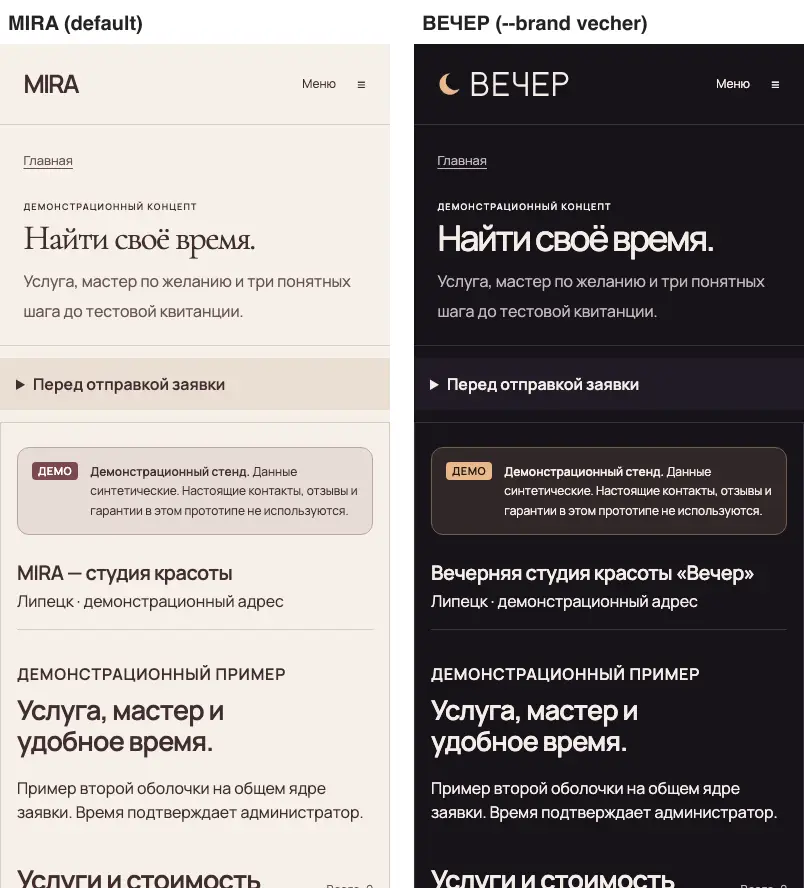 | 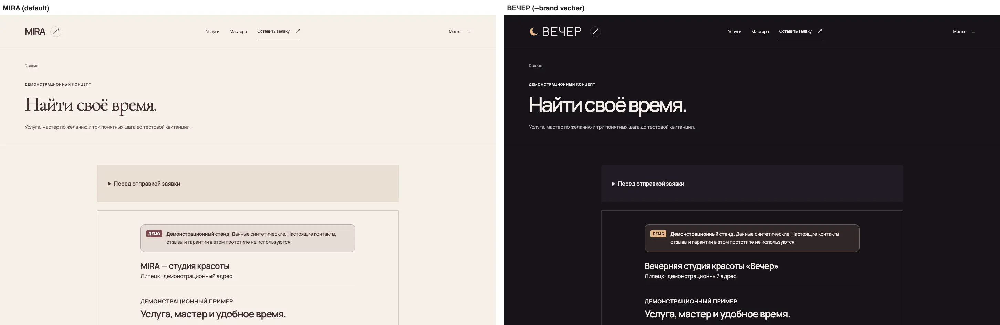 |
| Beauty, квитанция реальной заявки | 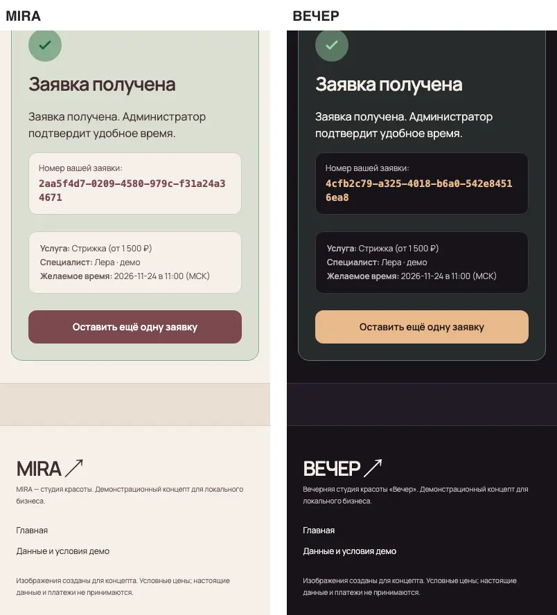 | — |
| Estimate, главная | 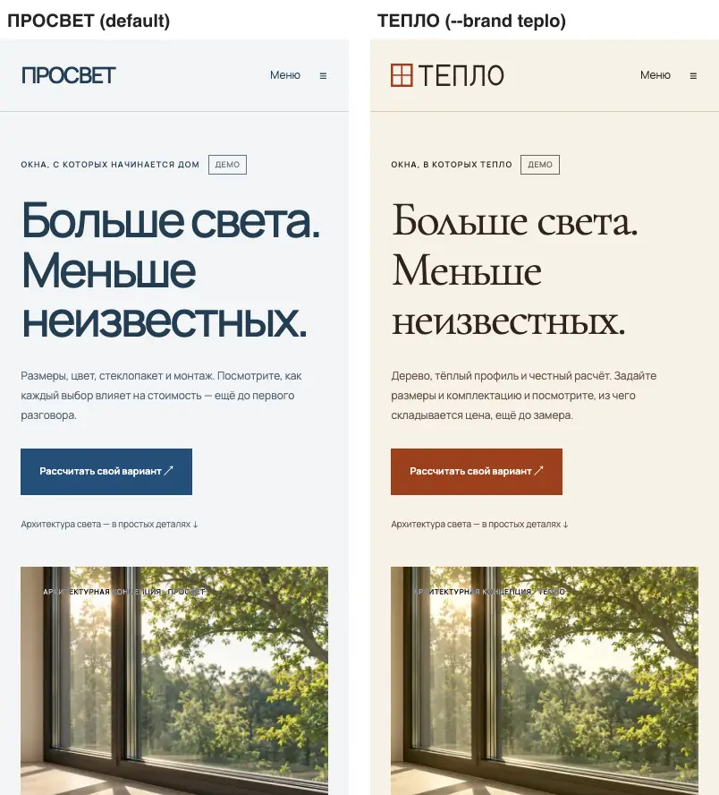 | 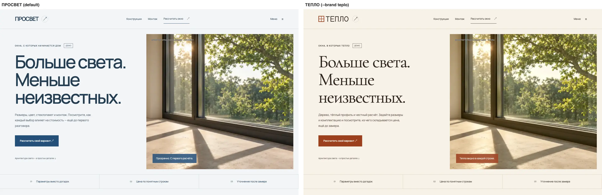 |
| Estimate, конструкции | 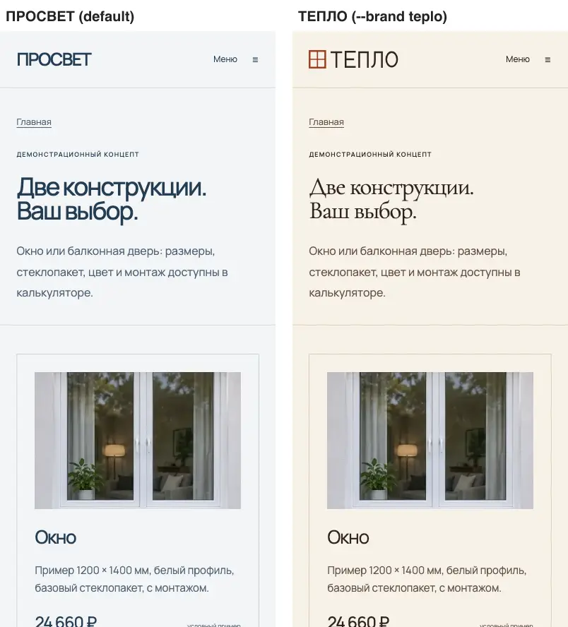 | 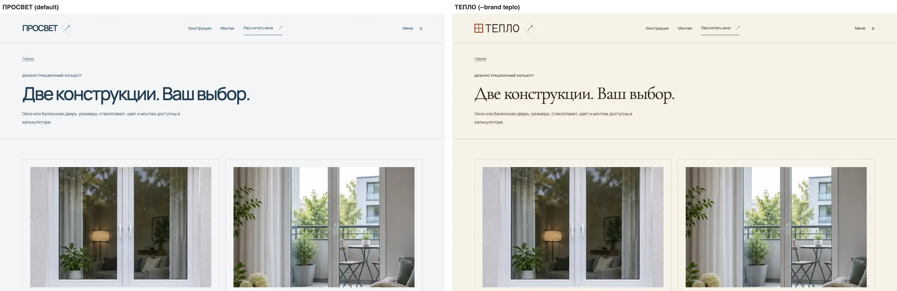 |
| Estimate, калькулятор | 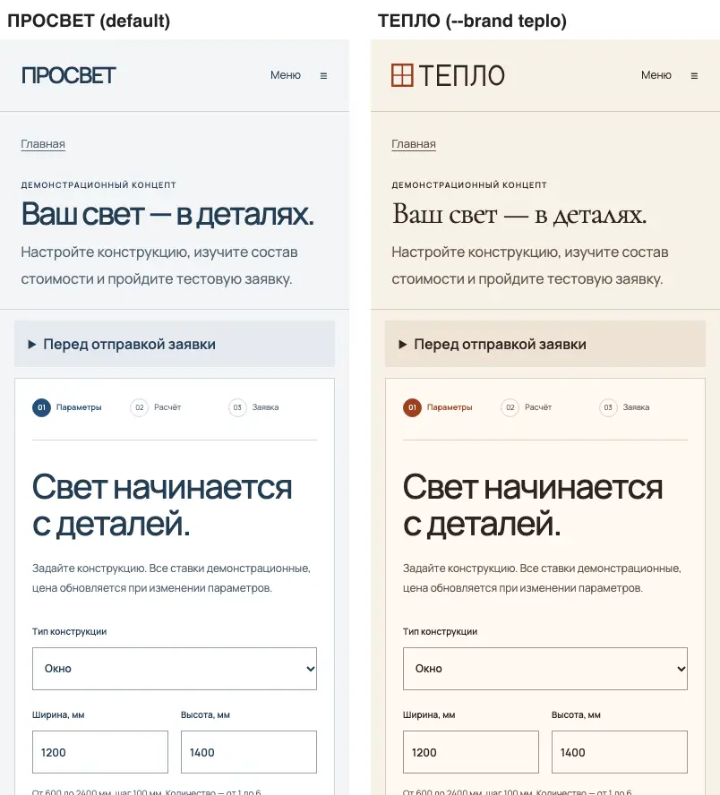 | 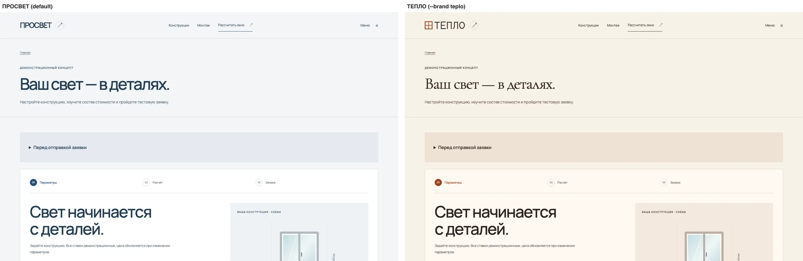 |
| Estimate, квитанция реальной заявки | 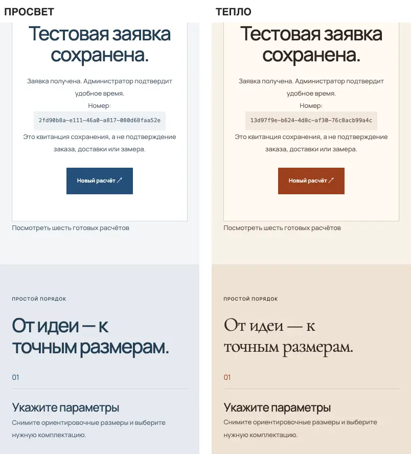 | — |

Восстанавливаемая ошибка сети у ВЕЧЕР: контакт сохранён, кнопка повтора в цветах бренда, повтор ушёл с тем же ключом идемпотентности и получил 201.

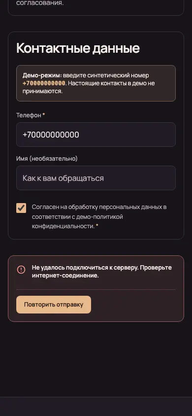

### Регрессия бренда по умолчанию

Доля пикселей, отличающихся от базового `2b8fbd8` (порог 24/765 по RGB):

| Экран | MIRA 390 | MIRA 1440 | ПРОСВЕТ 390 | ПРОСВЕТ 1440 |
| --- | ---: | ---: | ---: | ---: |
| Главная | 0,79 % | 0,27 % | 0,51 % | 0,85 % |
| Каталог | 1,84 % | 0,20 % | — | — |
| Форма / калькулятор | 10,44 % | 4,11 % | 2,08 % | 0,87 % |

Отличия намеренные. Приглушённый текст стал темнее, чтобы пройти 4,5 на surface (MIRA `#7b6467 → #6c5558`, ПРОСВЕТ `#5d7081 → #536576`). В форме вместо `Студия · Демо` теперь полное имя бренда. Жёлтый блок «Демо» и успех формы окрашены от палитры бренда. Поля калькулятора получили более контрастную границу. До/после формы MIRA:

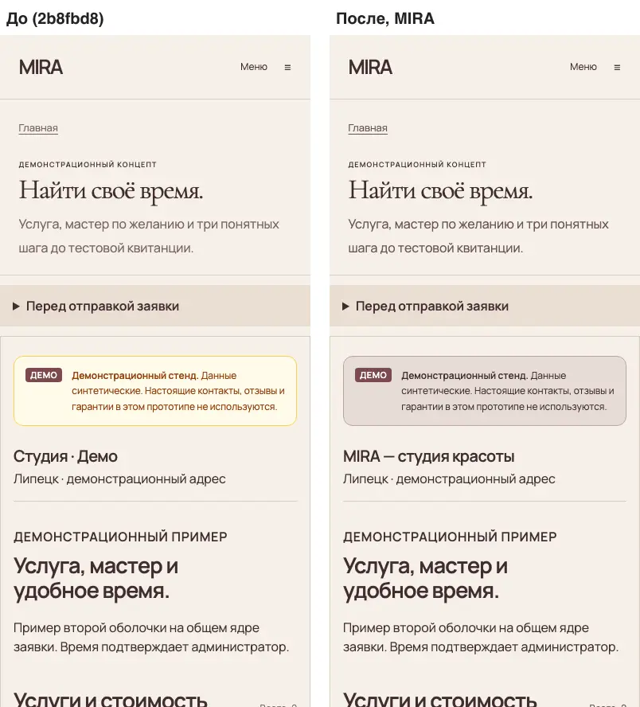

## Замер времени

Пробная адаптация ТЕПЛО выполнена строго по runbook: копирование примера, логотип, обработка фото, JSON, строка реестра, `check:brands`, `build`, два превью.

| Шаг | Время |
| --- | ---: |
| Копия примера, SVG-логотип, кадр через ffmpeg/cwebp | 0 с (команды) |
| JSON, регистрация, `check:brands` | 14 с |
| `npm run build` | 8 с |
| Остановка прежних превью | 11 с |
| Два превью (ПРОСВЕТ и ТЕПЛО) готовы | 1 с |
| **Итого машинного времени** | **34 с** |

Это прогон агентом с заранее продуманным дизайном. Подбор палитры до прохождения контраста, рисование логотипа и обработка фото человеком по оценке занимают 10–15 минут при готовых материалах клиента, плюс 5 минут на визуальную проверку 390/1440. Гипотеза 30–60 минут выглядит реалистичной с запасом, если бриф и права на материалы готовы. Измерение с оператором-человеком — следующий шаг.

Изменённые файлы при добавлении бренда без правки кода:

| Бренд | Новые файлы | Изменённые файлы |
| --- | --- | --- |
| ВЕЧЕР | `vecher.json`, `logo-on-dark.svg`, `logo-on-light.svg`, `hero.webp` | `registry.ts` (2 строки) |
| ТЕПЛО | `teplo.json`, `logo-on-light.svg`, `hero.webp` | `registry.ts` (2 строки) |

Ручной труд: подбор палитры, логотип, кадр, тексты. CSS и компоненты не менялись.

Цена динамического рендера (фабричный режим, 30 запросов, TTFB): статичная Medical p50 1 мс / p95 1 мс, динамические Beauty и Estimate p50 3 мс / p95 4 мс.

## Проверки

| Команда | Результат |
| --- | --- |
| `npm run check:plan` | PASS |
| `npm run check:brands` | 4 бренда, все пары контраста проходят |
| `npm run lint` | 0 ошибок, 0 предупреждений |
| `npm run typecheck` | PASS |
| `npm run test:ui` | 50/50 (43 прежних + 7 BR01–BR07) |
| `npm run test:backend` | 70/70 |
| `npm run build` | PASS; Beauty и Estimate — рендер на запрос, остальные оболочки и OBLIK статичны |
| `npm run test:e2e` | 152/152, Chromium и WebKit |
| `npm run test:integration` | 53/53 |
| `npm run test:system` | 13/13 |
| `npm run verify:demo-routes` | 69 страниц: 200, один H1, noindex |
| `npm run test:portfolio:system` | 21 проверка ширин, 6 реальных заявок, 6 повторов |
| `npm run test:demo-profiles` | 6 профилей + 2 ошибочные конфигурации |
| `npm run test:brands:system` | 4 превью из одного build, 4 реальные заявки, одинаковый payload у пары брендов, 3 неверных выбора → 503 |

`test:brands:system` ([результаты](client-branding/system-results.json)) проверяет для каждого бренда: заголовок вкладки, отсутствие чужого имени в HTML и RSC-данных, цвет фона из конфига, полное имя в подвале, логотип или текстовый fallback, Tab на skip-link и бренд с видимым outline, отсутствие горизонтальной прокрутки на 360/390/720 (200 % от 1440)/768/1440, reduced motion, недоступные шрифты, загрузку только нужных гарнитур, заявку через UI в тестовую PostgreSQL. Для ВЕЧЕР дополнительно — обрыв сети и повтор.

Тест нашёл и помог закрыть утечку: `estimate.json → brandName` («ПРОСВЕТ · демо») сериализовался в RSC-данные калькулятора ТЕПЛО. Теперь компонент получает имя активного бренда.

## Ограничения и следующие шаги

- Подключены только Beauty и Estimate; порядок остальных оболочек и исключения OBLIK — в ADR.
- Время человека-оператора не замерено; нужен один прогон с секундомером по runbook.
- Новые гарнитуры не добавлялись; каталог поддерживает их после согласования лицензии.
- Изменения в `src/proxy.ts`, `scripts/preview-*.mjs`, `package.json` выходят за зону фронтенда и вынесены на рассмотрение архитектору.
